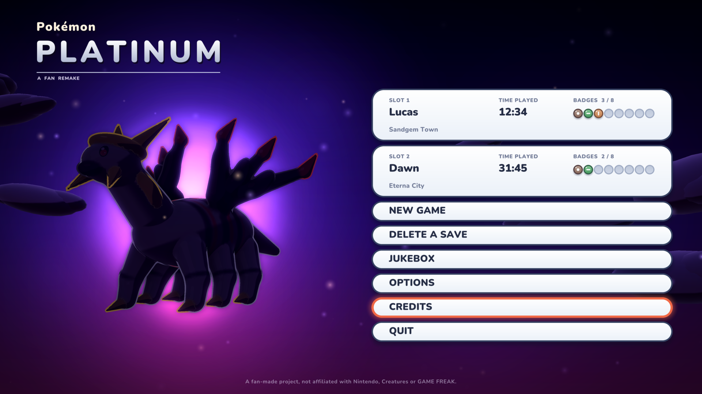
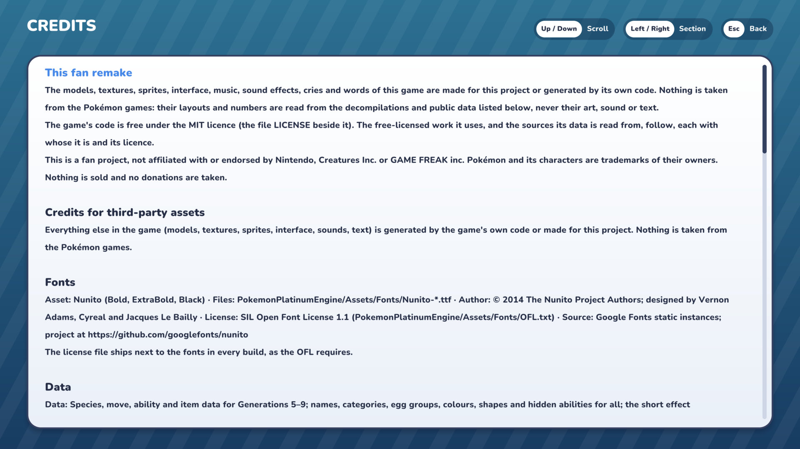

# Pokémon Platinum, a fan remake

A remake of Pokémon Platinum in C# (.NET 10) on [Raylib-cs](https://github.com/ChrisDill/Raylib-cs) 8.1 (raylib 6.0), built toward the whole game and, after Sinnoh, the regions the later games added. The field and the battles are 3D scenes; almost every asset (models, textures, sprites, music, sound, cries) is generated by the game's own code at start-up or made for this project.

> **A fan project.** It is not affiliated with or endorsed by Nintendo, Creatures Inc. or GAME FREAK inc. Pokémon and its characters are trademarks of their owners. **Nothing is taken from the games**: no sprites, models, textures, music, cries or script text. Layouts and numbers (where things are, what they are called, a move's power) are read from the public decompilations and PokeAPI; art, sound and dialogue are our own. Nothing is sold and no donations are taken. If you hold rights in something here and want it taken down, open an issue on the repository and it will be.

The code is under the MIT licence ([`LICENSE`](LICENSE)). The free-licensed work it uses is listed in [`docs/art/CREDITS.md`](docs/art/CREDITS.md) and the sources its data is read from in [`THIRD-PARTY-NOTICES.md`](THIRD-PARTY-NOTICES.md); the title's CREDITS shows both.

## Playing

You need the [.NET 10 SDK](https://dotnet.microsoft.com/download) and a graphics card with OpenGL 3.3. Windows, Linux and macOS build alike.

```bash
git clone <this repository>
cd antigravity-pokemon-test
dotnet run --project PokemonPlatinumEngine
```

The first start builds the Pokémon's and the characters' models and bakes the menu sprites as they are needed, and keeps them in `cache/` beside the executable, so later starts are faster. A first run asks a few questions before the title (language, text size, the buttons, the graphics preset, which it measures on your machine); everything can be changed later under OPTIONS.

[`docs/manual.md`](docs/manual.md) is the player's guide: the ways to play at NEW GAME, what differs from Platinum, the field moves and the helps.

### Switches

```bash
dotnet run --project PokemonPlatinumEngine -- --help          # every switch
dotnet run --project PokemonPlatinumEngine -- --windowed      # or --fullscreen, for this run only
dotnet run --project PokemonPlatinumEngine -- --safe-mode     # the Low preset in 1280×720, no mesh cache, no hand-made files or packs
dotnet run --project PokemonPlatinumEngine -- --where         # where the saves, the options and the log are kept, and why
dotnet run --project PokemonPlatinumEngine -- --save <folder> # keep them in that folder (--portable: in the folder the game is started in)
dotnet run --project PokemonPlatinumEngine -- --region Kanto  # a new game begun in Kanto instead of Sinnoh
```

### Controls

| Action | Keyboard | Pad |
| --- | --- | --- |
| Move, and move a cursor | Arrow keys or W A S D | Left stick or D-pad |
| A: talk, choose, confirm | Z or Space | A (bottom face button) |
| B: back, cancel | X or Esc | B (right face button) |
| Run (held) | Left Shift or X | B |
| Start menu | Enter or Tab | Start |
| The registered key item | C | X (left face button) |
| The Pokétch: out or away / next app / in hand | P / O / I | Y / R / L |
| A page back / on (bag, boxes, Pokédex) | Q / E | L / R |
| Full screen | F11 or Alt+Enter | |
| Mute | M | |
| Screenshot | F12 | |
| Report a problem (writes `repros/` beside the save) | F8 | |

Every key and button can be changed under OPTIONS → CONTROLS, and HELP there lists them as they stand.

### Where the game keeps its files

The three save slots (`save1.json` to `save3.json`, each with the save before it as a `.bak`), the options (`settings.json`), `log.txt`, screenshots and any crash report are kept in one folder: `%APPDATA%\PokemonPlatinum` on Windows, `$XDG_DATA_HOME/pokemon-platinum` (or `~/.local/share/pokemon-platinum`) on Linux and `~/Library/Application Support/PokemonPlatinum` on macOS, unless `--save`, `--portable` or a `portable.txt` beside the game says otherwise. `--where` says which folder and why, and touches nothing.

## Pictures





The game is looked at through its screenshot harness, which drives it into known states in a hidden window and saves the pictures (below, "Building and checking"). Every picture here was taken that way.

```bash
dotnet run --project tools/ShotHarness -- <out dir> title     # the opening, the title and its menu
dotnet run --project tools/ShotHarness -- <out dir> field     # Twinleaf Town and the routes round it
dotnet run --project tools/ShotHarness -- <out dir> battle    # a battle at each of its menus
```

## What is still missing

The roadmap is in [`docs/plans/`](docs/plans/README.md), with [`00-overview.md`](docs/plans/00-overview.md) the order of what is left. In short: Sinnoh's story is whole from the bedroom to the post-game, Kanto, Johto, Hoenn and much of Unova are played from their own decompiled or hand-drawn maps, and the regions after Unova, online play, release builds and part of the polish are still to come. There is no packaged release yet: the game is run from the source as above.

## Building and checking

```bash
dotnet build PokemonPlatinum.sln
dotnet test PokemonPlatinumTests
dotnet test PokemonPlatinumTests --filter "FullyQualifiedName~TitleCreditsTests"   # one class
dotnet run --project tools/ContentCheck                                             # the hand-written rooms, overlays and scripts held to their rules
dotnet run --project tools/DataImporter                                             # regenerate the species, moves, abilities, items and trainers
dotnet run --project tools/MapImporter -- --quick                                   # Sinnoh's maps from the decompilation
```

[`CLAUDE.md`](CLAUDE.md) lists every command of every tool and how the code is laid out; [`CONTRIBUTING.md`](CONTRIBUTING.md) says how to join in.
